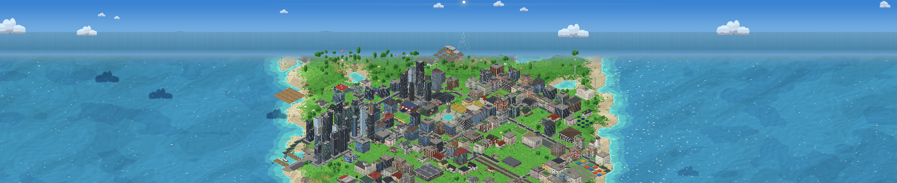
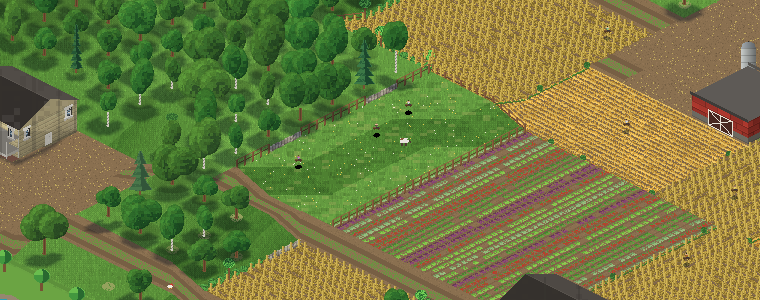
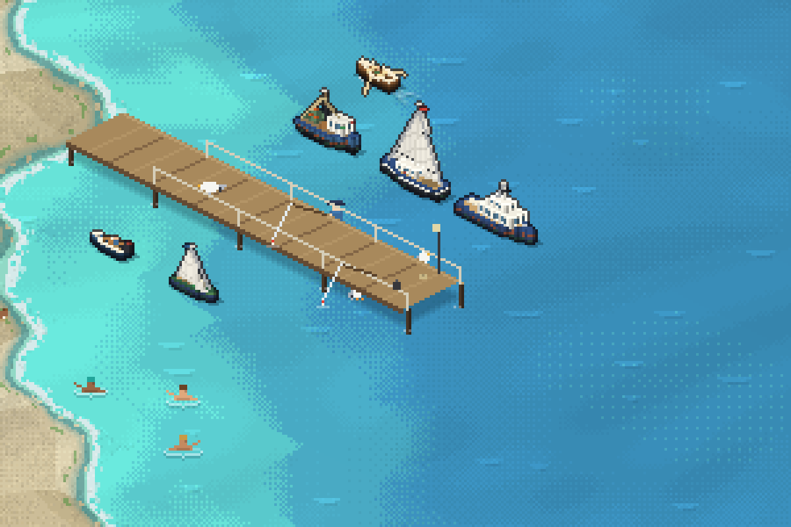

# Citylive 2

A tiny isometric pixel-art city that lives on your desktop. It founds a settlement, grows it through the ages, and
follows the real world: the sun, moon and stars for where you are, the weather outside, the seasons, holidays, the
occasional aurora or ISS pass. It runs as a **live wallpaper** on Windows 11 and on Linux (KDE Plasma, GNOME, X11),
written in Rust, drawn on the CPU, and built to use very little of it.






## Install on Windows 11

1. Download `Citylive2-Setup-<version>.exe` from the [latest release](https://github.com/Deluxescout1/citylive-2/releases/latest).
2. Run it. **Windows may say "Windows protected your PC"** because the installer is not code-signed (signing
   certificates cost money). Click **More info**, then **Run anyway**.
3. Pick the options (start with Windows is ticked by default) and finish. The wallpaper starts, with an icon in the
   system tray.

It installs for your user only (`%LOCALAPPDATA%\Programs\Citylive 2`), needs no administrator rights, adds *Citylive 2*
and *Citylive 2 Settings* to the Start menu, and shows up in *Settings, Apps*. If the old Electron "CityLive" is
installed, the installer offers to stop it and turn off its autostart (it does not delete it).

No installer? `Citylive2-<version>-windows-x64.zip` is a portable copy: unpack it anywhere and run `citylive.exe`.

## Install on Linux (x86_64)

```sh
curl -fsSL https://raw.githubusercontent.com/Deluxescout1/citylive-2/main/install.sh | sh
```

The script is short and readable; it downloads the latest release, checks it against the release's `SHA256SUMS`, and
installs it for your user (nothing needs root):

- programs in `~/.local/share/citylive-2`, links in `~/.local/bin` (`citylive-2`, `citylive-2-settings`);
- a **systemd user service** `citylive-2.service` that starts with your graphical session;
- a *Citylive 2 Settings* entry in the application menu;
- on **KDE Plasma** it offers to build the Plasma wallpaper module and make Citylive 2 your wallpaper. That needs
  `cmake`, a C++ compiler and the Qt 6 development packages
  (Debian/Ubuntu: `sudo apt install cmake g++ qt6-base-dev qt6-base-private-dev qt6-declarative-dev`;
  Fedora: `sudo dnf install cmake gcc-c++ qt6-qtbase-devel qt6-qtbase-private-devel qt6-qtdeclarative-devel`;
  Arch: `sudo pacman -S --needed cmake gcc qt6-base qt6-declarative`). Without them it still installs, and you can run
  `sh ~/.local/share/citylive-2/install.sh --install-plasma` once they are there;
- on **GNOME** and **X11** it uses the GNOME shell extension and the X11 presenter that ship in the tarball. These
  are simpler than the Plasma one and do not show every feature. Other Wayland compositors with layer-shell support
  (sway, Hyprland and so on) use the main program directly.

Options: `--yes` (no questions), `--no-plasma`, `--version X.Y.Z`, `--presenter plasma|wayland|gnome|x11`,
`--no-service`. Run `sh install.sh --help` for the list.

Prefer packages? Each release also has `citylive-2_<version>_amd64.deb` (system-wide; start it with
`systemctl --user enable --now citylive-2.service`; updates come from your package manager) and the plain tarball
`citylive-2-<version>-linux-x86_64.tar.gz`.

**Uninstall:** `sh ~/.local/share/citylive-2/uninstall.sh` (add `--purge` to delete your saved worlds and settings too).

## Settings and location

Open **Citylive 2 Settings** from the Start menu, the application menu, or the tray icon. You can change the pace of
growth, how busy the streets are, zoom, the amount of sky, weather (live, fixed or off), holidays, personal dates
(birthdays and anniversaries get balloons or fireworks), and which live feeds are on.

**Location** decides the sun, the seasons and the weather. By default Citylive 2 finds it for you: first the
operating system's location service (Windows Location, GeoClue on Linux) if you have allowed it, then a free
IP-address lookup, and it remembers the last answer. Until it knows, it uses Greenwich. Turn *Detect my location
automatically* off to set a place yourself (search by name, or type the coordinates); nothing is detected then.

Your settings are one readable file: `%APPDATA%\CityLive\config.toml` on Windows, `~/.config/citylive-iso/config.toml`
on Linux. Saved cities are next to it (`%LOCALAPPDATA%\CityLive`, `~/.local/share/citylive-iso`).

## Updates

Citylive 2 looks at this project's GitHub releases when it starts and every six hours (never while a full-screen app
is in front, and at most once an hour). When a newer release exists it downloads the file for your system in the
background, checks it against the release's `SHA256SUMS`, and installs it **the next time the program starts**
(Windows: the installer runs silently for your user; Linux: the files are swapped and the program restarts itself).
Turn it off with *Check for updates automatically* in the settings, or `auto_update = false` in the config file;
*Check now* is there too. Only the per-user installs update themselves; the `.deb` and the portable zip do not.

## Privacy

There is no account, no telemetry, no analytics, and nothing is uploaded from your computer. Citylive 2 only asks
public services for data, and each request carries only what the service needs to answer:

| Service | What for | What it sees |
| --- | --- | --- |
| api.open-meteo.com, geocoding-api.open-meteo.com | weather, place search | your latitude and longitude, your search words |
| ipapi.co, ipwho.is, get.geojs.io, reallyfreegeoip.org | finding your place by IP address (only while *Detect my location* is on and the OS gave no answer) | your IP address, as any website sees it |
| api.github.com, github.com | looking for and downloading updates | your IP address |
| api.airplanes.live, api.open-notify.org, services.swpc.noaa.gov | aircraft overhead, the ISS, the aurora (each can be switched off) | your approximate latitude and longitude (flights only) |
| site.api.espn.com | Bills game scores (can be switched off) | nothing about you |

The detected place is cached on your computer (latitude, longitude, name; never your IP address).

## Build from source

```sh
cargo build --release -p wallpaper -p settings     # Rust 1.85 or newer
cargo test --workspace --exclude present_gnome     # the full suite is slow; CI runs the quick subset
```

Windows builds are cross-compiled from Linux with `bin/build-windows.sh` (MSVC target through `cargo-xwin`), and the
installer with `bin/build-installer.sh` (NSIS). Linux packages: `bin/package-linux.sh`. Releases are built by GitHub
Actions when a `v*` tag is pushed (`.github/workflows/release.yml`).

## Licence

MIT, see [LICENSE](LICENSE). Copyright (c) 2026 Deluxescout1.
